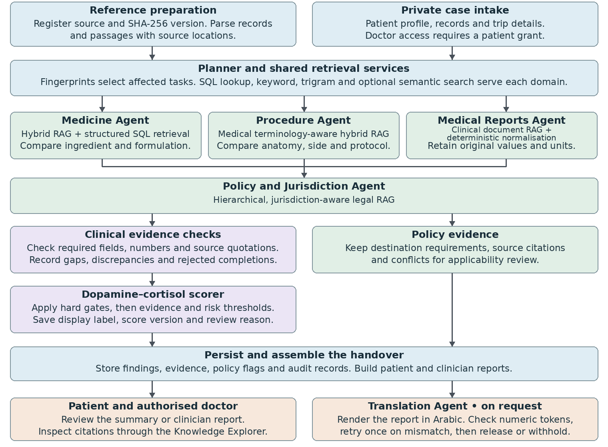

**AI for Good Sandbox Hackathon – “Team Netaxis”**

# HealthBridge: A Multi-Agent Framework with Neuro-Inspired Evidence Scoring for Cross-Border Healthcare \| هيلث بريدج: إطار متعدد الوكلاء لتقييم الأدلة بنظام نقاط مستوحى من آليات الجهاز العصبي في الرعاية الصحية العابرة للحدود

**Mentor:** Dr. Nethravathi K A

**Team leader:** Jaya Sri Jawahar Sripathy

**Team:** Netaxis, RVCE Bangalore

**Members:** Dr. Nethravathi K A, Jaya Sri Jawahar Sripathy, Bhavika Bandu and Shriyam Adya Sharma  
**Contact details:**

**Email IDs:**

<nethravathika@rvce.edu.in>, <jayasrijawahar.ec23@rvce.edu.in>, <bhavikabandu.cs23@rvce.edu.in>, <shriyamadyas.cs23@rvce.edu.in>

**Phone Number:**

+91 7353986060, +91 8088306317, +91 8884781224, +91 9827183496

Github link: <https://github.com/BhavikaBandu/HealthBridge-Team-Netaxis-RVCE>

## 1 Introduction

**Background:** A patient continuing treatment in Dubai shares prescriptions, reports and procedure notes with the receiving doctor. The doctor needs the original clinical details and the destination’s healthcare and medicine guidance to interpret the records.

**Problem Statement:** Across borders, medicine names, procedure descriptions, laboratory units and report formats vary. Patients and clinicians must reconcile those differences and identify which destination rules apply before they can complete the handover.

Example. An Indian prescription lists a brand name. A UAE product contains the same ingredient, but the prescription omits whether the tablet is immediate-release or extended-release. The receiving doctor needs to confirm the formulation before assessing suitability.

**Proposed Solution:** HealthBridge uses four retrieval-augmented generation (RAG) workflows to compare medicines, procedures and reports and retrieve destination policies. It reuses details from patient records, cites the supporting evidence and flags unresolved findings for the clinician. Patients receive a Travel Health Summary with Arabic translation available on request.

**Role of AI:** The proposed solution uses agentic AI because one finding can determine what needs to be checked next. For example, the Medicine Agent identifies the active ingredient in a prescription, and the Policy Agent uses it to find the destination’s travel rules. The system brings these findings together with procedure and report checks, cites the evidence, and flags unresolved questions for the clinician.

### Knowledge Base

The expanded handoff contains 341 registered source files across the groups below, from which the application selects references for the India-to-Dubai workflow.

| **Source group** | **Files** | **Role in HealthBridge**                                              |
|------------------|-----------|-----------------------------------------------------------------------|
| ITU              | 8         | Y.3172 architecture and AI Readiness 2.0 mapping.                     |
| Global           | 114       | Clinical terminology, unit definitions and patient-summary standards. |
| UAE              | 57        | Product registration, traveller guidance and Dubai health policies.   |
| India            | 34        | Medicine and healthcare references for interpreting source records.   |
| Switzerland      | 67        | Swiss product and medicine-information references.                    |
| US, EU and UK    | 61        | Supporting resources including RxNorm and RxTerms.                    |
| Total            | 341       | Registered source files in Healthcare_Data_Handoff_EXPANDED.zip       |

### Demo scenarios

**Reading the scores:** Dopamine (D) and cortisol (C) are software scores calculated from evidence checks. No hormone levels or biological signals are measured. Higher D indicates stronger support for a finding. Higher C indicates more gaps or risk.

#### Scenario 1. India to UAE

**Medicine Agent:** Crocin Advance 500 mg matched Panadol Advance 500 mg, and Augmentin DUO matched Augmentin 1 g by active ingredient. The check raised no flag for the recorded ibuprofen allergy. Augmentin scored D 1.00, C 0.03.

**Procedure Agent:** A Dubai 3T MRI service matched the requested knee MRI with medium confidence (D 0.74, C 0.39). The listing covered joints generally and did not confirm a knee-specific protocol.

**Report Agent:** Glucose of 108 mg/dL converted to 5.99 mmol/L and creatinine of 0.78 mg/dL to 68.95 µmol/L. The lab report scored D 0.97, C 0.12. The agent also checked the prescription for missing details.

**Policy Agent:** The sources identified tramadol as controlled but differed on advance approval. The handover flagged the conflict and advised confirming the requirement with the authority and carrying the prescription \[6\].

#### Scenario 2. UAE to Switzerland

**Medicine Agent:** The agent matched Glucophage 850 mg to Metformin-Mepha 850 mg and Medikinet MR 20 mg to Methylphenidat-Mepha LA 20 mg by ingredient and strength. Glucophage scored D 0.87, C 0.42. The unknown tablet coating limited the allergy check.

**Procedure Agent:** The resting ECG matched the Swiss term Ruhe-EKG with high confidence (D 0.88, C 0.05).

**Report Agent:** The agent converted HbA1c of 7.5% to 58.46 mmol/mol and retained the original value.

**Policy Agent:** The planned 60-day supply of Medikinet exceeded the 30-day personal-use limit identified in the retrieved Swiss guidance. The handover advised the patient to contact Swissmedic \[12\].

## 2 Description of the use case

- **Patient input:** A patient continuing treatment in another country adds their medicines, procedure records, medical reports and destination to HealthBridge. The patient chooses which doctor can access the records.

- **Clinical review:** HealthBridge helps the receiving doctor interpret what was prescribed, what procedures were recorded and how test results were reported. It compares medicine ingredients and formulations, checks procedure details and preserves original test values when explaining differences in units.

- **Policy review:** HealthBridge retrieves destination-specific guidance relevant to the patient’s medicines and identifies documentation requirements or conditions that need confirmation.

- **Handover:** The patient receives a Travel Health Summary. The doctor receives a detailed report showing what the records establish, which sources support each finding and what still needs clarification before treatment decisions are made.

### Uniqueness of Solution

- **Integrated handover:** HealthBridge brings clinical information and destination-specific policy requirements into one handover.

- **Four specialised retrieval workflows:** Each agent looks for the details that matter to its task, such as a medicine’s release type, a procedure’s body site, a laboratory unit or a policy’s conditions.

- **Neuro-inspired evidence scoring:** The dopamine score reflects supporting evidence, while the cortisol score reflects gaps and risk. These scores help flag clinical findings for review. Mandatory review rules take priority.

- **Traceable findings:** The doctor can follow a finding back to its source and see which detail remains uncertain. Destination-policy flags carry their own citations.

### System architecture

*Figure 1. System Architecture: The three clinical agents run in parallel. Policy flags and scored clinical findings meet when HealthBridge assembles the handover.*

### How neuro-inspired evidence scoring works

The fixed dc-1 scorer combines evidence completeness (35%), code–model agreement (25%), comparison completion (20%) and response checks (20%) into the dopamine score D. The cortisol score C combines important gaps (35%), contextual risk (25%), a contradiction term (25%, currently zero) and rejected checks or quotes (15%).

Hard failures and mandatory review rules take priority. Otherwise C ≥ 0.50 triggers review. D ≥ 0.90 with C \< 0.15 permits the “Validated” display label. Other findings show limitations. These labels describe the evidence available for review.

### Tools and technologies

| **Component**        | **Technology**                                  | **Role in the prototype**                                            |
|----------------------|-------------------------------------------------|----------------------------------------------------------------------|
| Web application      | Python, FastAPI, Jinja2, Bootstrap              | Patient and clinician portals, uploads and reports.                  |
| Storage and search   | PostgreSQL, SQLAlchemy, SHA-256                 | Versioned evidence, structured lookup, full-text and trigram search. |
| Semantic retrieval   | Multilingual MiniLM, cosine similarity          | Optional passage matching for queries with different wording.        |
| Orchestration and AI | LangGraph, Qwen3 via Ollama                     | Schedule agents and generate local, evidence-grounded responses.     |
| Scoring and security | Python rules, Argon2id, session and CSRF checks | Assess findings, protect sign-in and check requests.                 |

### Five AI agents

| **Agent**               | **RAG workflow / input**                                                         | **Output and review boundary**                                                       |
|-------------------------|----------------------------------------------------------------------------------|--------------------------------------------------------------------------------------|
| Medicine                | Medicines RAG matches ingredients across countries and retrieves product labels. | Compares strength, form, route and release type. Missing attributes stay visible.    |
| Procedure               | Procedures RAG searches terms and provider texts by modality, site and side.     | Checks modality, anatomy, side and protocol. Broad matches retain their limitations. |
| Medical Reports         | Reports RAG retrieves analyte references and UCUM unit definitions.              | Preserves original findings. Labels conversions based on AI estimates.               |
| Policy and Jurisdiction | Policy RAG retrieves destination clauses and controlled-medicine rules.          | Returns cited requirements and conflicts for applicability review.                   |
| Translation             | Completed English report                                                         | Produces Arabic text and checks numeric tokens before release.                       |

### Application features

| **Feature**                | **What the user can do**                                          |
|----------------------------|-------------------------------------------------------------------|
| History and trip profile   | Record medicines, upload documents and specify the destination.   |
| Patient-controlled access  | Grant or revoke a verified doctor’s access.                       |
| Cross-border handover      | Read a patient summary or a detailed clinician report.            |
| Evidence and review labels | See cited findings, limitations and reasons for clinician review. |
| Knowledge Explorer         | Inspect reference material behind a comparison or policy flag.    |
| English and Arabic reports | Read the English report or request an Arabic version.             |

## 3 Use case requirement

- **Traceability.** Preserve original values, source versions and passage locations. Mark AI estimates and missing attributes explicitly.

- **Patient control.** Require an active access grant for clinician review, enforce revocation and record access events.

- **Usability and oversight.** Reuse details already in the case, minimise repeat questions and direct unresolved findings to a clinician. Clinical and medicine-import decisions remain with the responsible professionals and authorities.

## 4 Mapping with ITU-T Y.3172, Readiness 2.0 Report and domain-specific policies

The table maps all seven Y.3172 node functions \[1\] to the implemented workflow and the relevant qualitative readiness dimensions \[2\]. The numbered references identify the standards and policy provisions used in the design.

| Node | Use case | Readiness 2.0 Report | Documents (policies/strategies/innovative regulations) |
| --- | --- | --- | --- |
| SRC Source | Patients supply clinical records and trip details. Publishers supply product, terminology and policy references. | D1 Data/model marketplace. D4 Regional context. | UAE Health ICT Law [3]. DHA consent and access standard [7]. |
| C Collector | The portal receives private uploads. The reference importer registers files and their version hashes. | D1 Data/model marketplace. D13 Digital infrastructure. | Health ICT Law, Arts 13 and 16 [3]. DHA access controls [7]. |
| PP Preprocessor | Parsers extract product fields, lab values and units. They retain original text and source locations. | D5 Integration of AI in workflows. | UCUM unit definitions [8]. Health ICT Law [3]. |
| M Model | Each workflow retrieves domain evidence. Local Qwen generates structured interpretations where needed. | D5 Workflow integration. D13 Digital infrastructure. | WHO health AI guidance [9]. DHA AI policy §§4.2–4.3 [4]. |
| P Policy | Application rules gate the display of clinical findings. The jurisdiction agent supplies separate flags for destination rules. | D8 Collaboration with AI. D10 AI and policies. | DHA AI policy [4]. UAE Medical Products Law [5]. EDE traveller guidance [6]. |
| D Distributor | The application assembles cited findings and flags into audience-specific reports and serves them through access-controlled portals. | D5 Workflow integration. D6 Human interface. | Health ICT Law [3]. DHA consent and access standard [7]. |
| SINK Recipient | The patient reads the travel summary. The authorised doctor reviews flagged items and inspects their sources. | D6 Human interface. D8 Collaboration with AI. | DHA accountability provisions [4]. WHO human-autonomy guidance [9]. |

## 5 Error scenarios

**1. No UAE product match for tramadol 50 mg.** The search returned no matching product. The handover advised local confirmation. Evidence was incomplete (D 0.62), and controlled-medicine status raised the risk score (C 0.25).

**2. No Swiss ingredient match for Ganaton 50 mg.** The search found no product containing itopride. The handover advised discussing alternatives with the clinician before travel. Evidence was incomplete (D 0.62), and the policy check raised no controlled-medicine flag (C 0.07).

## 6 Policy gaps and standards gaps derived from the mapping exercise

### Policy gaps identified in applying the sources

- **Which rule applies?** A stricter travel rule may concern a different patient category or import route. Each flag needs an authority, effective date and applicability check before a reviewer resolves conflicting clauses \[5,6\].

- **Who may receive the record?** A patient grant controls access within HealthBridge. Real deployment also requires an institutional decision on hosting, retention and the legal basis for a cross-border transfer \[3,7\].

- **Which edition governs?** The cited DHA AI policy lists July 2026 as its review date. Confirm the edition in force before relying on it for deployment \[4\].

### Standards and implementation gaps

- **Cross-border mappings.** A shared ingredient or procedure term still needs clinical context. A reviewed mapping should preserve formulation, laterality, units, original values and source provenance \[8\].

- **Interoperable handover.** A receiving system needs an agreed exchange profile for results, uncertainty and citations. FHIR profile validation and integration with national systems remain open \[11\].

- **Evidence evaluation.** Clinicians need to evaluate thresholds against reviewed cases. The contradiction term is currently inactive, and an AI-estimated conversion can receive a display-valid label. A matching quotation also needs review to confirm that it supports the proposed value \[4,9\].

## References

\[1\] ITU-T Y.3172 (06/2019), Architectural framework for machine learning in future networks including IMT-2020, 8.1.

\[2\] ITU, AI Ready – Analysis Towards a Standardized Readiness Framework, 2025, Chapter 3.

\[3\] UAE Federal Law 2/2019 concerning ICT in health fields, Articles 13 and 16.

\[4\] DHA, Artificial Intelligence in the Healthcare Policy, HISHD/PP-09, issue 01, 4.2–4.3, referenced edition.

\[5\] UAE Federal Decree-Law 38/2024 governing medical products, pharmacists and pharmaceutical establishments, Articles 5, 38 and 76.

\[6\] EDE, Issue of Permit to Import Medicines for Personal Use, conditions and FAQ.

\[7\] DHA, Standards for Consent and Access Control, HISHD/ST-09, referenced edition.

\[8\] Regenstrief Institute, The Unified Code for Units of Measure (UCUM).

\[9\] WHO, Ethics and Governance of Artificial Intelligence for Health, 2021.

\[10\] Team NetAxis, HealthBridge repository, inspected 7 November 2026.

\[11\] HL7, FHIR Release 4 specification.

\[12\] Swissmedic, Travelling with controlled medicines: other countries.
